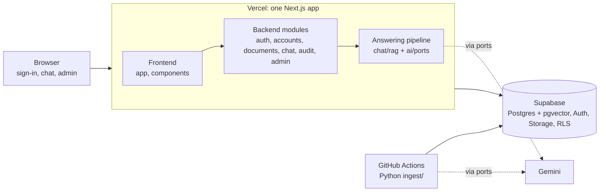
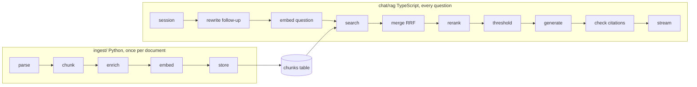

# Architecture

Mirror of Appendix G of the FinThropic proposal. Change this file only through an ADR.

## The three areas and where they live

One Next.js app (frontend and backend together), one Supabase project, one Python worker.

| Area | Folders | Owners (roles confirmed at sprint planning) |
| --- | --- | --- |
| **Frontend** | `web/src/app/` (pages), `web/src/components/<group>/` (feature packages), `common/`, `hooks/`, `stores/`, `utils/`, `config/` | Frontend 1 (chat), Frontend 2 (sign-in, admin screens, shared UI) |
| **Backend** | `web/src/server/modules/` (six modules), `middlewares/`, `config/`, `supabase/` | Backend 1 (auth, accounts, audit, middlewares, database), Backend 2 (documents, admin, CI) |
| **AI** | answering: `web/src/server/modules/chat/rag/` and `web/src/server/ai/`; indexing: `ingest/`; measuring: `eval/` | AI/RAG 1 (answering, gateway, eval), AI/RAG 2 (indexing) |
| **Shared** | `web/src/contracts/` (wire shapes), `.github/`, `docs/` | Project Leader |

## System: three tiers and one worker



One app, one deploy (modular monolith). No microservices at about 50 users.

## Frontend: one direction

Page, Component package, Hook, Service, HTTP helper, backend Route. A package never imports another package.

| Layer | Folder | Rule |
| --- | --- | --- |
| Page | `app/(guest)`, `(member)`, `(admin)` | route groups by role; the layout checks the role on the server; the page only composes packages and shared UI |
| Component package | `components/<group>/<Package>/` | `index.tsx` view only, `sub-components/`, one hook, one service. The group is a business area with the same name as the backend module: `chat`, `documents`, `accounts`, `auth`, `audit` (plus `health` for the example) |
| Hook | `use<Name>.hook.ts` | state and handlers, no JSX |
| Service | `<name>.service.ts` | knows the routes, calls `utils/http.ts` with the contract schema; the response is parsed, unknown fields are dropped, a wrong type is an error |
| Contract (DTO on the wire) | `contracts/<module>.dto.ts` | one zod schema per response and the type inferred from it; used by the backend DTO and by the frontend service; imports only zod and other contracts |
| Shared UI | `common/ui/` (shadcn/ui), `common/lib/` | no business logic, no data fetching (ADR 0006) |

Groups and packages: `chat/` (ChatWindow, CitationViewer), `documents/` (DocumentManager, UploadBatch), `accounts/` (AccountManager; ConsentNotice comes with PBI-016), `auth/` (SignIn and Welcome come with PBI-042 and PBI-043), `audit/` (AuditLog). Working example to copy: `health/HealthBadge`.

TypeScript types are erased at build time, so a cast such as `data as Health` checks nothing. Every service parses its response with the contract schema (`getJson(path, schema)`). Never spread a response into props and never use `dangerouslySetInnerHTML` (an ESLint rule fails on it). See ADR 0011.

## Backend: six modules, five layers each

Route, Controller, Service, Repository, Model, plus DTO, validator, interface, constants. `index.ts` is the module's only door.

| Module | Does | Owns tables |
| --- | --- | --- |
| auth | reads the session, returns the role | none |
| accounts | create, deactivate, import accounts, consent | profiles |
| documents | batches, signed URLs, status, delete, reclassify, search over chunks | documents, upload_batches, chunks |
| chat | conversations and the answering pipeline | conversations, messages |
| audit | writes and lists audit events | audit_logs |
| admin | dashboard numbers, orchestration only | none |

SQL only in a repository. HTTP only in a route or controller. Business rules only in a service.
A module writes only its own tables and uses other modules only through their `index.ts`.
Every file under `web/src/server/` imports `server-only`. Working example: `modules/health/`. Routes are listed in `ENDPOINTS.md`, tables in `MODELS.md`.

## AI part

Pipes and filters: one step per file, a runner chains them.
Ports and adapters: steps call `Embedder`, `LanguageModel`, `Reranker`; the provider SDK lives only in `server/ai/adapters/` (and `ingest/ai/` for the worker).



Rerank is optional. Nothing relevant means the fallback reply and no model call.

## Supabase clients

`createUserClient(token)` for anything a member triggers (Row Level Security applies).
`createAdminClient()` only for admin jobs and the worker (bypasses Row Level Security). See ADR 0005.

## Repository folders and owners

Folder tree of the scaffold, three levels deep. Folders marked "later" do not exist yet; the named PBI creates them.

```
finthropic/
├── .github/                    shared: CI, CodeQL, Dependabot, templates, code owners
│   ├── workflows/
│   └── ISSUE_TEMPLATE/
├── docs/                       shared: architecture, standard, endpoints, models, runbook
│   └── adr/                    shared: one file per decision
├── eval/                       AI: question sets, runner, metrics (later, PBI-012)
├── fixtures/                   AI: synthetic test files (real club files stay out of git)
│   └── private/                git-ignored
├── ingest/                     AI: indexing job in Python
│   ├── steps/
│   ├── ai/
│   ├── repositories/
│   ├── models/
│   └── tests/
├── supabase/                   backend: migrations and pgTAP tests (later, PBI-002)
└── web/                        one Next.js app
    ├── scripts/                shared: build checks (secret scan of the browser output)
    └── src/
        ├── app/                frontend: pages by role, plus thin API routes
        ├── components/         frontend: groups by business area, one folder per feature package inside each
        ├── contracts/          shared by both sides: zod schemas of the data on the wire (DTO)
        ├── common/             frontend: shared UI (shadcn)
        ├── hooks/              frontend: shared hooks
        ├── stores/             frontend: shared state
        ├── utils/              frontend: HTTP helper
        ├── config/             frontend: route map
        ├── server/             backend and AI: modules, ai, middlewares, config, utils
        └── test/               shared: test helpers
```

Owners follow the sub-issues; reviewers follow CODEOWNERS. Roles are proposals until sprint planning confirms them. Review rule: Quoc Khanh (Project Leader) reviews security and cross-cutting paths (auth, accounts and roles, audit, Row Level Security and permissions, `.github/`, architecture rules, contracts, ADRs, migrations). Peers in the same role pair review the rest (Backend 1 and 2, AI/RAG 1 and 2, Frontend 1 and 2). Quoc Khanh's own pull requests are reviewed by Khoa Đỗ only when Khanh asks, otherwise by no one.

| Folder | What it holds | Owner (name and role) | PBIs | Reviewer |
| --- | --- | --- | --- | --- |
| `web/src/app/(guest)` | Sign-in and welcome pages | Tri Dung (Frontend 2) | PBI-042, PBI-043 | Carl Bradley |
| `web/src/app/(member)` | Chat and consent pages | Carl Bradley (Frontend 1) | PBI-005, PBI-016, PBI-019 | Tri Dung |
| `web/src/app/(admin)` | Admin pages | Tri Dung (Frontend 2) | PBI-023 | Carl Bradley |
| `web/src/app/api` | Thin route files; each belongs to the module it calls | Owner of that module | Module PBIs | Reviewer of that module; Quoc Khanh for sign-in, users and citations routes |
| `web/src/components/chat/ChatWindow` | Question box, answer, Markdown, history | Carl Bradley (Frontend 1) | PBI-005, PBI-011, PBI-019, PBI-028, PBI-029, PBI-030 | Tri Dung |
| `web/src/components/chat/CitationViewer` | Source view for pages, sections, sheets and rows | Tri Dung (Frontend 2) | PBI-019 | Carl Bradley |
| `web/src/components/documents/DocumentManager`, `documents/UploadBatch`, `accounts/AccountManager`, `audit/AuditLog` | Admin screens | Tri Dung (Frontend 2) | PBI-021, PBI-022, PBI-023 | Carl Bradley |
| `web/src/components/auth/SignIn`, `auth/Welcome`, `accounts/ConsentNotice` | Sign-in form, guest welcome page, privacy notice | Tri Dung (Frontend 2) | PBI-016, PBI-042, PBI-043 | Carl Bradley |
| `web/src/components/health/HealthBadge` | Example package to copy | Carl Bradley (Frontend 1) | PBI-044 | Tri Dung |
| `web/src/contracts` | Wire shapes (zod DTO) shared by the backend DTOs and the frontend services; each contract is agreed by the two owners of that endpoint | Project Leader owns the rule; the module owner writes the file | PBI-044, PBI-045 | Quoc Khanh |
| `web/src/common` | Shared UI kit (shadcn/ui) | Tri Dung (Frontend 2) | PBI-046 | Carl Bradley |
| `web/src/hooks`, `stores`, `utils`, `config` | Shared hooks, state, HTTP helper, route map | Carl Bradley (Frontend 1) | PBI-044 | Tri Dung |
| `web/src/server/modules/auth` | Sessions and roles | Dang Khoa (Backend 1) | PBI-015, PBI-017, PBI-018, PBI-042 | Quoc Khanh |
| `web/src/server/modules/accounts` | Accounts, consent, roster import | Dang Khoa (Backend 1) | PBI-015, PBI-016, PBI-031 | Quoc Khanh |
| `web/src/server/modules/documents` | Batches, signed URLs, status, delete, reclassify, versions, search | Trong Giap (Backend 2) | PBI-014, PBI-021, PBI-022 | Dang Khoa |
| `web/src/server/modules/audit` | Audit events | Dang Khoa (Backend 1) | PBI-022 | Quoc Khanh |
| `web/src/server/modules/admin` | Dashboard numbers | Trong Giap (Backend 2) | PBI-036 | Dang Khoa |
| `web/src/server/middlewares` | Request wrappers: error handler, auth, role, rate limit | Dang Khoa (Backend 1) | PBI-015, PBI-017, PBI-018, PBI-044 | Quoc Khanh |
| `web/src/server/config`, `utils` | Environment check, Supabase clients, logger | Quoc Khanh (Project Leader) | PBI-044 | Khoa Đỗ only when Khanh asks, otherwise none |
| `supabase/migrations` | Schema, Row Level Security, search functions | Dang Khoa (Backend 1) | PBI-002, PBI-009, PBI-021, PBI-022 | Quoc Khanh |
| `supabase/tests` | pgTAP database and permission tests | Dang Khoa (Backend 1) | PBI-002, PBI-018 | Quoc Khanh |
| `web/src/server/modules/chat` (with `rag/`) | Conversations and the ten answering steps | Minh Khoi (AI/RAG 1) | PBI-004, PBI-009, PBI-010, PBI-017, PBI-030 | Gia Phat |
| `web/src/server/ai` | AI gateway: ports, Gemini adapter, reranker adapter | Minh Khoi (AI/RAG 1) | PBI-004, PBI-032 | Gia Phat |
| `ingest` | Indexing job: parse, chunk, enrich, embed, store | Gia Phat (AI/RAG 2) | PBI-003, PBI-007, PBI-008, PBI-024 | Minh Khoi |
| `eval` | Runner and metrics (Minh Khoi), question sets (Quoc Khanh) | Minh Khoi (AI/RAG 1) and Quoc Khanh (Project Leader) | PBI-012, PBI-013, PBI-020 | Gia Phat; for Khanh's sets: Khoa Đỗ only when Khanh asks, otherwise none |
| `fixtures` | Synthetic test files; real club files stay in the git-ignored private folder | Gia Phat (AI/RAG 2) | PBI-003 | Minh Khoi |
| `.github/workflows` | CI, CodeQL, manual evaluation run | Trong Giap (Backend 2) | PBI-001, PBI-045 | Quoc Khanh |
| `.github` (templates, CODEOWNERS, Dependabot) | PR and issue templates, code owners, dependency updates | Quoc Khanh (Project Leader) | PBI-001, PBI-045 | Khoa Đỗ only when Khanh asks, otherwise none |
| `docs` | Architecture, endpoints, models, coding standard, decisions (ADRs), operations runbook | Quoc Khanh (Project Leader); runbook by Trong Giap | PBI-046 | Khoa Đỗ only when Khanh asks, otherwise none; Quoc Khanh reviews ADRs written by others |
| `scripts` (root, later) and `web/scripts` | Measurement and report scripts; build checks | Trong Giap (Backend 2) | PBI-014, PBI-036, PBI-045 | Dang Khoa |
| Repository root files | README, LICENSE, SECURITY, CONTRIBUTING, editor and Node settings | Quoc Khanh (Project Leader) | PBI-001, PBI-046 | Khoa Đỗ only when Khanh asks, otherwise none |

The folder structure and all example code are created by Quoc Khanh in PBI-001, PBI-044, PBI-045 and PBI-046. The owners in the table take over once the skeleton is tagged `v0.1.0-skeleton`.

## How the rules are enforced

| Rule | Tool | Where |
| --- | --- | --- |
| Layer direction, module doors, package isolation, pure contracts, provider SDK only in adapters, no cycles | dependency-cruiser (`bun run arch`), 14 named rules | `web/.dependency-cruiser.cjs`, ADR 0007 |
| No `process.env` outside `server/config`, no `dangerouslySetInnerHTML`, medium strict lint | ESLint (`bun run lint`) | `web/eslint.config.mjs`, ADR 0004 |
| Missing or malformed environment variables stop the app at start | zod in `server/config/env.ts` | `web/src/instrumentation.ts` |
| No secret in the browser output | `bun run check:bundle` after the build | `web/scripts/check-bundle-secrets.ts` (PBI-045.5) |
| Every check above, plus Python lint, types and tests, PR title, secret scan, CodeQL (ADR 0013) | GitHub Actions | `.github/workflows/` |

A rule failure names the rule. Do not work around a rule; if it is wrong, open an ADR.

## Diagrams

Edit these in draw.io (desktop, or diagrams.net: File, Open from, Device): the `.drawio.svg` file keeps the editable diagram inside the image.

| Diagram | File |
| --- | --- |
| Architecture: three parts and one worker | `docs/diagrams/architecture.drawio.svg` |
| Data model (planned until PBI-002) | `docs/diagrams/er-diagram.drawio.svg` |
| Sequence: sign in and role check | `docs/diagrams/sequence-sign-in.drawio.svg` |
| Sequence: ask a question | `docs/diagrams/sequence-ask-question.drawio.svg` |
| Sequence: open a citation | `docs/diagrams/sequence-open-citation.drawio.svg` |
| Sequence: upload a batch and index it | `docs/diagrams/sequence-upload-index.drawio.svg` |
| Sequence: retry a failed document | `docs/diagrams/sequence-retry-document.drawio.svg` |
| Sequence: delete or reclassify a document | `docs/diagrams/sequence-delete-reclassify.drawio.svg` |
| Sequence: create, import or deactivate accounts | `docs/diagrams/sequence-manage-accounts.drawio.svg` |
| Sequence: view the audit log | `docs/diagrams/sequence-audit-log.drawio.svg` |
| Sequence: list or delete conversations | `docs/diagrams/sequence-conversations.drawio.svg` |

## Decisions

One short ADR per decision in `docs/adr/`, from the template `0000-template.md`. A new pattern needs an ADR approved by the Project Leader.
